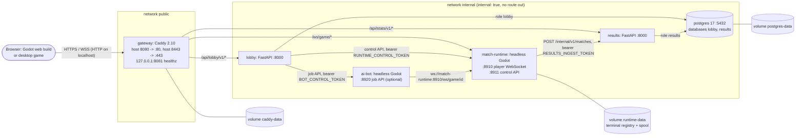
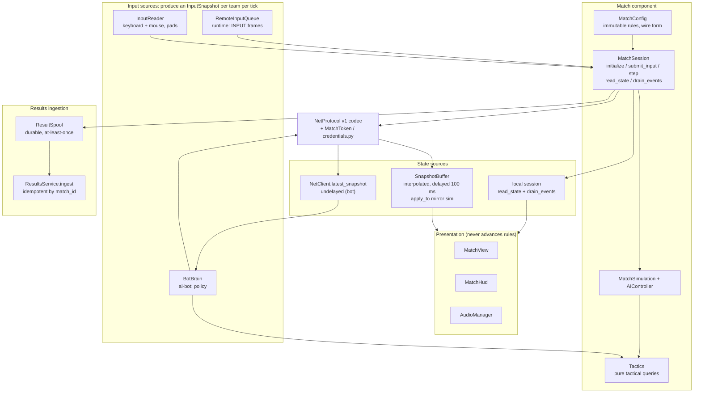
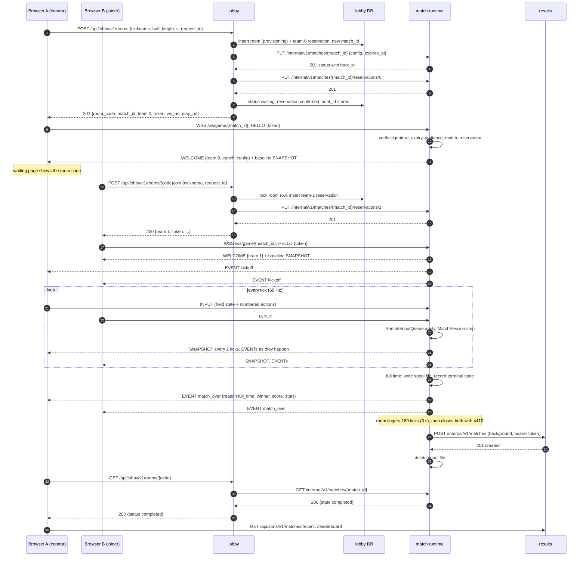
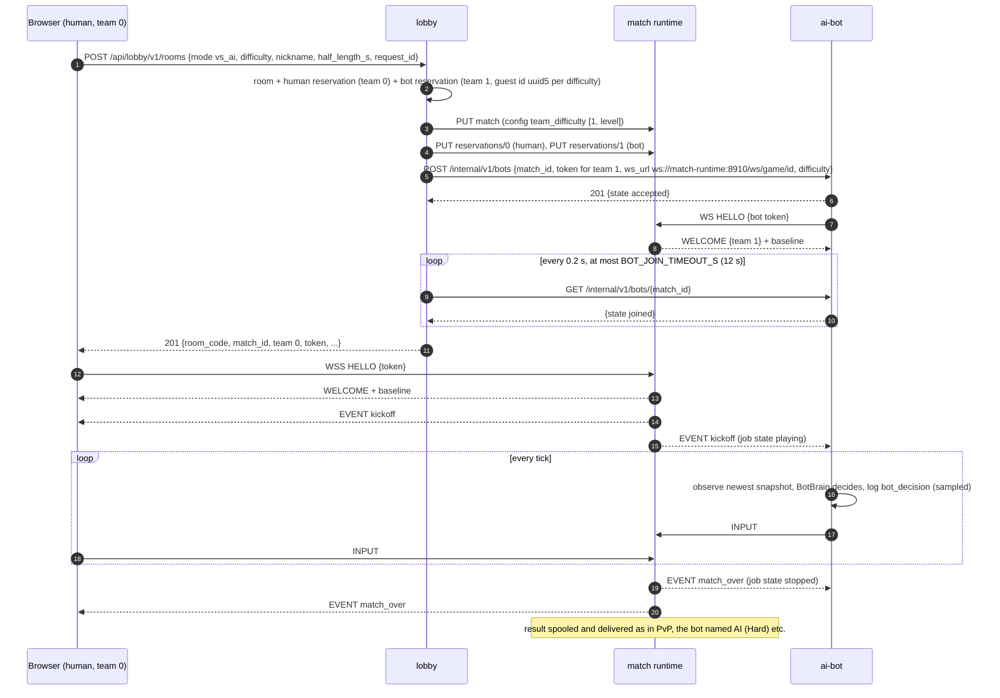

# Online architecture: microservices, software components and the AI agent

This is the reference for the online two-player system built on top of the Godot 3D
game (Milestones 0-6). It maps the assignment brief to evidence, then documents the
deployment, the reusable components, every contract (derived from the code), the match
lifecycle, failure handling, security and the known limitations. The step-by-step
presentation runbook is [`docs/demo.md`](docs/demo.md); measured numbers are in
[`docs/measurements.md`](docs/measurements.md); the AI opponent is detailed in
[`docs/ai_bot.md`](docs/ai_bot.md). The rendering and gameplay report of the 3D build
itself is [`AS_BUILT.md`](AS_BUILT.md).

## Resumo (pt-BR)

**Tema da disciplina:** "Um Jogo Digital não Violento Usando Microservices e Componentes
de Software [e AgentesAI]".

- **Jogo digital não violento:** futebol arcade 11 contra 11 em 3D (Godot 4.7). O
  objetivo é marcar gols com passe, posicionamento e trabalho em equipe. O desarme
  (*tackle*) serve só para recuperar a bola. Não há sangue, lesão, dano, barra de vida
  nem recompensa por atingir jogadores. Um desarme por trás é falta e dá tiro livre ao
  adversário (fair play). Os chutes especiais são efeitos visuais da bola.
- **Microsserviços:** três serviços de negócio, cada um com processo, imagem Docker,
  testes, *health check* e dados próprios: **lobby** (salas, convidados, reservas,
  credenciais assinadas), **match runtime** (partidas autoritativas em Godot headless,
  registro de partidas encerradas e *spool* durável de resultados) e **results**
  (histórico e ranking). O **ai-bot** é um quarto serviço opcional. O gateway (Caddy) e o
  PostgreSQL são infraestrutura. Os serviços conversam só por contratos HTTP/WebSocket
  versionados, e só o gateway publica portas.
- **Componentes de software:** o mesmo `MatchSession` + `MatchConfig` roda a partida
  offline (controlador 3D), no servidor (`MatchRoom`) e como espelho de observação do
  bot. O codec `NetProtocol` é compartilhado por navegador, desktop, servidor e bot.
  `MatchToken` (GDScript) e `credentials.py` (Python) implementam o mesmo formato de
  credencial, verificado por vetores de teste comuns. `Tactics` é usado pela IA interna
  e pelo bot.
- **Agentes de IA (opcional):** o ai-bot é um agente heurístico autônomo (não é um LLM).
  Ele tem um objetivo (vencer), observações (o snapshot mais recente), um ciclo
  decidir/agir em intervalos de reação por dificuldade e ações pela mesma interface de
  um humano. As decisões ficam registradas em log (`bot_decision`).
- **Evidências:** matriz de requisitos abaixo; roteiro de demonstração em
  [`docs/demo.md`](docs/demo.md); seis suítes Godot, duas suítes pytest e scripts e2e
  com navegador, todos rodando no CI (`.github/workflows/ci.yml`).

## 1. Requirements matrix

The brief: *"Um Jogo Digital não Violento Usando Microservices e Componentes de Software
[e AgentesAI]"* (a nonviolent digital game using microservices and software components,
optionally AI agents). Microservices and software components are mandatory; agentic AI
is optional. This matrix is our reading of that wording, not a confirmation of an
undisclosed rubric.

| Requirement | How it is met | Evidence (files, tests, demo) |
| --- | --- | --- |
| **Digital game** | An 11-v-11 arcade football game in Godot 4.7, with a 3D night-stadium presentation. Offline play (1P vs AI, local 2P) and online play in the browser. | `scenes/main_3d.tscn`, `scripts/match_controller_3d.gd`; `tests/run_scene_smoke.gd` plays a full offline match; `tests/e2e/online_menu.mjs` plays a full online match in two browsers; demo steps 3 and 9. |
| **Nonviolent** | The objective is scoring goals. Tackles only win the ball, and a tackle from behind is a foul that gives the opponent a free kick. There are no health points, injuries, damage, blood or knockouts, and nothing rewards hitting a player. Special shots are named visual effects on the ball. The player-facing text was reviewed for this (section 9). | `MatchSimulation._resolve_ball_capture` / `_is_foul_tackle` (`scripts/systems/match_simulation.gd`); stats are possession, shots, on target, steals, fouls and offsides (`menu_manager.gd`); section 9 of this document. |
| **Microservices** (mandatory) | Three business services: **lobby**, **match runtime** and **results**. Each has its own entry point, image, configuration, tests, health endpoint and data. They talk only through versioned HTTP/WebSocket contracts. **ai-bot** is a fourth, optional business service. The gateway and PostgreSQL are infrastructure. Failures stay isolated: results down delays history but not play, and ai-bot down only disables vs-AI. | `docker-compose.yml`; `services/lobby`, `services/results`, `scripts/server`, `scripts/bot`; sections 2-5 and 7; `tests/e2e/run_failure_checks.sh`, `tests/e2e/run_bot_checks.sh`; demo steps 6-7. |
| **Software components** (mandatory) | A small number of modules with documented interfaces, reused by different adapters: `MatchSession` + `MatchConfig` (offline controller, `MatchRoom` on the runtime, the bot's observation mirror, the bot-strength benchmark); `NetProtocol` (browser, desktop, runtime, bot); `MatchToken` and `credentials.py` (one credential contract in two languages, checked by shared vectors); `Tactics` (in-sim AI and bot); `ControlServer` (runtime control API, bot job API, fake results service in tests). | Section 3; `scripts/match/`, `scripts/net/`, `scripts/ai/tactics.gd`, `scripts/server/control_server.gd`; `tests/run_sim_tests.gd` (seeded reproducibility, per-session slow motion), `tests/run_net_tests.gd`, `tests/vectors/token_vectors.json` used by `tests/run_runtime_tests.gd` and `services/lobby/tests/test_credentials.py`. |
| **AI agents** (optional) | The ai-bot is an autonomous heuristic agent. Its goal is to win. It observes the newest snapshot, decides in a loop paced by a per-difficulty reaction time, and acts only through the player input protocol. Its decisions are logged and its strength is measured. It is **not** an LLM or a learned model: if the course defines "AgentesAI" as LLM-based agents, this criterion is not met. | [`docs/ai_bot.md`](docs/ai_bot.md); `scripts/bot/bot_brain.gd`, `bot_session.gd`; `tests/run_bot_tests.gd`; `tests/measure_bot_strength.gd` (results in `docs/measurements.md`); `docker compose logs ai-bot \| grep bot_decision`; demo steps 5 and 8. |

**What the system does not claim.** There are no user accounts. Players are guest UUIDs,
which is enough for a demo leaderboard but not for competitive ranking integrity. There is
one runtime instance and one ai-bot instance, with no replica routing. There is no
client-side prediction. A match lost to a runtime crash before its result is spooled
is not recovered. Section 11 lists every known limitation.

## 2. Service map

### 2.1 Deployment

One repository and one Compose project (`docker-compose.yml`, project name
`inazuma-online`). The gateway is the only container with published ports and the only
one on the `public` network; it also joins `internal` to reach the services. Everything
else sits only on `internal`, a Compose network declared `internal: true`, so those
containers have no route to the outside world.



| Container | Image (build) | Entry point | Listens | Health check | State |
| --- | --- | --- | --- | --- | --- |
| `gateway` | `tools/godot/Dockerfile` target `gateway` (Caddy + the Web export) | `caddy run` with `services/gateway/Caddyfile` | `:80`, `:443` (published as `GATEWAY_HTTP_PORT` 8080, `GATEWAY_HTTPS_PORT` 8443), `127.0.0.1:8081` | `wget http://127.0.0.1:8081/healthz` | `caddy-data` (certificates) |
| `match-runtime` | target `match-runtime` (Linux Server export) | `inazuma_server.x86_64 --headless` (dedicated-server feature -> `scenes/server.tscn`) | `:8910`, `:8911` | `curl :8911/health` | `runtime-data` at `/data` |
| `lobby` | `services/lobby/Dockerfile` target `service` | `uvicorn app.main:create_app --factory` | `:8000` | `GET /health` (runs `SELECT 1`) | PostgreSQL database `lobby` |
| `results` | `services/results/Dockerfile` target `service` | `uvicorn app.main:create_app --factory` | `:8000` | `GET /health` (runs `SELECT 1`) | PostgreSQL database `results` |
| `ai-bot` | target `ai-bot` (the same Linux Server export) | `inazuma_server.x86_64 --headless -- --bot` (-> `scenes/bot.tscn`) | `:8920` | `curl :8920/health` | none (sessions live in memory) |
| `postgres` | `postgres:17-alpine` | `services/postgres/init/10-service-databases.sh` on first start | `:5432` | `pg_isready -h 127.0.0.1` | `postgres-data` |

Start order comes from `depends_on: condition: service_healthy`. postgres and
match-runtime start first, then lobby and results, then the gateway once runtime, lobby
and results are healthy. ai-bot depends only on the runtime, and the lobby does **not**
depend on ai-bot, so the stack runs without it. Every container uses Docker's `json-file`
log driver, rotated at 5 x 10 MB.

All three Godot images come from one Dockerfile and one engine: the official Godot
4.7.2 Linux binary and export templates, checked against their SHA-512 sums. The
`project` stage imports once; the `export-web` stage builds the browser client (Web
preset: single-threaded, Compatibility renderer), and `export-server` builds the
dedicated-server binary (Linux Server preset, `dedicated_server=true`) that serves as
both runtime and bot. `scripts/bootstrap.gd` decides the process role before loading
any presentation, and it checks `--bot` before the `dedicated_server` feature because
both roles share that export.

### 2.2 Gateway routes (`services/gateway/Caddyfile`)

| Path | Goes to | Notes |
| --- | --- | --- |
| `/ws/game/*` | `match-runtime:8910` | WebSocket upgrade; the browser's player connection |
| `/api/lobby/v1/*` | `lobby:8000` | the `/api/lobby` prefix is stripped |
| `/api/stats/v1/*` | `results:8000` | the `/api/stats` prefix is stripped |
| `/api/*` (anything else) | 404 `{"error":"not_found"}` | the internal APIs are never routed |
| `/healthz` | 200 `ok` | public liveness |
| everything else | `/srv/web` | static Web export; `.pck` served as `application/octet-stream` |

`SITE_ADDRESS` picks the mode: the default `:80` serves plain HTTP for local use, and a
domain name makes Caddy obtain a Let's Encrypt certificate and redirect HTTP to HTTPS.
Responses are compressed with `encode zstd gzip`, with an explicit type list that adds
wasm and octet-stream (the `.pck`). The web export is single-threaded, so no COOP/COEP
headers are needed. Godot's web build only starts in a secure context:
`http://localhost` qualifies, while any other host needs HTTPS.

## 3. Software components

A component here is a module with a small documented interface whose state it owns,
used by more than one adapter. A GDScript class can be a component: being a component
does not require a container of its own. The headers of the files named below are the
detailed specifications (initialization order, validation, error modes, ownership).



| Component | Interface | Owns | Defined in |
| --- | --- | --- | --- |
| **MatchConfig** | `to_dict()` / `from_dict(d)` (null when invalid) / `validate()` / `copy()`; fields `version`, `half_length_s` (30-900), `formations`, `kits`, `team_difficulty` (0-2 per team), `fouls_enabled`, `offside_enabled`, `weather` | nothing mutable: a session keeps a private copy | `scripts/match/match_config.gd` |
| **MatchSession** | `set_team_device(team, device)` before `initialize(config, seed)`; then `submit_input(team, input)`, `step(real_dt)`, `read_state()`, `drain_events()`, `dispose()` | the `MatchSimulation` and `AIController`, the match clock, halves, goal freeze, half-time pause, and its own slow-motion `time_scale` (`Engine.time_scale` stays 1) | `scripts/match/match_session.gd` |
| **Input source** | anything that fills the team's `InputSnapshot` (axis, sprint, shoot held/prev, pass/switch/tackle pressed, aim) before `step` | its own device or queue state | `InputReader.read(teams, timer)`, `RemoteInputQueue.apply(snap, tick)`, `BotBrain.step(sim, playing, dt) -> InputSnapshot` |
| **State source** | match summary + ordered events + a `MatchSimulation` to read | the buffered snapshots / events | local: `MatchSession.read_state` / `drain_events`; online: `SnapshotBuffer.sample(now)` / `take_due_events(now)` / `apply_to(mirror, a, b, t)` |
| **Protocol codec** | `NetProtocol.encode_*` / `decode(bytes)` (`{}` when malformed); `MatchToken.sign` / `verify` | nothing | `scripts/net/protocol.gd`, `scripts/net/match_token.gd`, `services/lobby/app/credentials.py` |
| **Presentation** | `MatchView.update_visuals(visual_dt)` reads a sim; the controller's `_dispatch_event(ev)` turns events into view / HUD / audio cues | nodes, materials and animation state only | `scripts/systems/match_view.gd`, `match_hud.gd`, `audio_manager.gd`, `scripts/match_controller_3d.gd` |
| **Tactics** | static, pure queries: best pass target, open dribble lane, shot target, nearest opponent, opposing keeper | nothing (draws no random numbers) | `scripts/ai/tactics.gd` |
| **Results ingestion** | `ResultSpool.write(result)` + `poll()` -> `POST /internal/v1/matches` -> `ResultsService.ingest(document, result) -> (status, reply)` | the spool files / the `matches` and `match_players` tables | `scripts/server/result_spool.gd`, `services/results/app/service.py` |
| **ControlServer** | bounded nonblocking HTTP/1.1 listener: `listen(port)`, `poll()`, `handler(method, path, headers, body) -> {status, body}` | its connections | `scripts/server/control_server.gd` |

### 3.1 Who reuses what

| Adapter | MatchSession / MatchConfig | Input source | State source / presentation | Codec |
| --- | --- | --- | --- | --- |
| **Offline game** (`match_controller_3d.gd`, Play Now) | steps a local session built from `SettingsStore` + the setup screen | `InputReader` for human teams; `AIController` inside the sim for AI teams | local session -> `MatchView` / `MatchHud` / `AudioManager` via `_dispatch_event` | not used |
| **Match runtime** (`MatchRoom`) | steps one session per room, config from the lobby's provisioning | `RemoteInputQueue` per team, filled from INPUT frames | none: encodes `snapshot_from_session` + events for the clients | encode snapshots / events, decode HELLO / INPUT / PING; `MatchToken.verify` |
| **Online game** (same controller, `start_online`) | a never-stepped mirror session, initialized from WELCOME's config | `InputReader` -> `NetClient.send_input` | `SnapshotBuffer.apply_to` writes the mirror sim, so the same `MatchView` / HUD / `_dispatch_event` code renders it | encode HELLO / INPUT / PING, decode the rest |
| **ai-bot** (`BotSession`) | a never-stepped mirror session as the observation | `BotBrain` -> `NetClient.send_input` | `NetClient.latest_snapshot` (undelayed); no presentation | same client codec as the game |
| **Benchmark** (`tests/measure_bot_strength.gd`) | steps local sessions | `BotBrain` on the session's own state | none | not used |

The controller's online adapter is deliberately thin: it applies interpolated snapshots
to `session.sim` and dispatches runtime events through the same `_dispatch_event` as
offline play, so the view, HUD and audio have no online-specific code. The mirror is a
compatibility adapter. It only works because presentation reads gameplay fields and
never writes them, and because `apply_to` leaves animation timers and node references
alone.

### 3.2 Component guarantees and how they are tested

- **Same rules everywhere.** Online and offline matches run the identical
  `MatchSession.step`. `tests/run_online_smoke.gd` runs a runtime and two full 3D games
  in one process; `tests/run_scene_smoke.gd` plays an offline match to full time.
- **Reproducible within a build.** The session seeds `sim.rng` before building the
  teams, and all gameplay randomness uses it. `run_sim_tests.gd` checks that the same
  config, seed and inputs give the same match. This does not promise cross-platform
  lockstep, and the authoritative design does not need it.
- **Rooms are independent.** Slow motion is per session. `run_sim_tests.gd` checks that
  a special shot in session A does not change session B's clock.
- **Rules never read local preferences.** `MatchSimulation` reads `sim.config` (a
  `MatchConfig`), never `SettingsStore`. Offline, the settings seed the config; online,
  the lobby's provisioning sets it.
- **One credential contract in two languages.** `tests/vectors/token_vectors.json`,
  generated by `tests/vectors/generate_token_vectors.py` and checked in CI with
  `git diff --exit-code`, is reproduced byte for byte by `credentials.py` (pytest) and
  `MatchToken` (`run_runtime_tests.gd`).

## 4. Data ownership

Each service owns its data and no service reads another's storage. PostgreSQL is one
instance with **two databases and two login roles** (`lobby`, `results`), created on the
first start by `services/postgres/init/10-service-databases.sh`, with `REVOKE ALL ...
FROM PUBLIC` on each database. Each service creates or updates its own schema on start
(`CREATE TABLE IF NOT EXISTS` under an advisory lock).

| Service | Data it owns | Where | Schema / format | Who else sees it, and how |
| --- | --- | --- | --- | --- |
| **lobby** | guest identities (`players`), rooms (`rooms`: room code, independent `match_id` UUID, mode, difficulty, config, last observed status, runtime `boot_id`, credential expiry, create `request_id`), team reservations (`reservations`: unique per room and team, unique `request_id`, `confirmed`) | database `lobby` | `services/lobby/app/db.py` | clients through `/api/lobby/v1`; the runtime receives the config and reservations through the control API |
| **match runtime** | live matches (memory), the terminal-match registry, the result spool | memory; `/data/terminal_matches.json`; `/data/spool/<match_id>.json`, `/data/spool/rejected/` on volume `runtime-data` | `scripts/server/terminal_registry.gd`, `result_spool.gd` | the lobby reads status through `GET /internal/v1/matches/{id}`; results receive each result by POST |
| **results** | match history (`matches`: exact submitted document + canonical SHA-256 hash), per-player read model (`match_players`: goals, points, outcome, `counted`) | database `results` | `services/results/app/db.py` | public reads `/api/stats/v1/matches/recent`, `/leaderboard` |
| **ai-bot** | live bot sessions and finished jobs (kept 10 minutes) | memory only | `scripts/bot/bot_service.gd` | the lobby through the job API |
| gateway (infra) | TLS certificates, ACME account | volume `caddy-data` | Caddy | none |

Identifiers: `match_id` is a UUID the lobby allocates independently of the
human-readable six-character room code (alphabet without `0 O 1 I`). Neither the room
code nor the nickname is an identity: the guest `player_id` is a lobby-issued UUID, and
the bot plays as `uuid5(6f1c3a52-9d4e-4c1b-8a57-2f0e8b7d4c21, "ai-bot:<difficulty>")`.

## 5. Contracts

Everything below is taken from the code. The authoritative copies are the docstrings
and headers of the named files; when the two disagree, the code wins.

### 5.1 Public HTTP (through the gateway)

**Lobby** (`services/lobby/app/main.py`, `service.py`, `reconcile.py`). The gateway maps
`/api/lobby/v1/...` to the lobby's `/v1/...`. Errors are `{"error": code, "detail":
text}`; validation errors are 422 `{"error": "invalid_request", "detail": [{field,
message}]}`. Unknown body fields are rejected (`extra="forbid"`).

| Route | Request | Success | Errors |
| --- | --- | --- | --- |
| `POST /api/lobby/v1/rooms` | `{nickname, half_length_s?, request_id, mode?, difficulty?, player_id?}`. `nickname`: 1-16 characters of letters, digits, space, `_ . -` (trimmed). `half_length_s`: integer 30-900, default 120. `request_id`: `[A-Za-z0-9_-]{8,64}`. `mode`: `"pvp"` (default) or `"vs_ai"`. `difficulty`: `"easy"`, `"normal"` (default) or `"hard"`, only with `vs_ai`. `player_id`: a returning guest's UUID. | **201** `{room_code, match_id, team: 0, player_id, reservation_id, nickname, token, expires_at, ws_url: "/ws/game/<match_id>", play_url: "/?match=<match_id>&token=<token>"}`. Sent only after the runtime has confirmed the match and the reservation (for `vs_ai`, also after the bot has joined team 1). Idempotent: the same `request_id` with the same parameters returns the same room and a credential again. | 404 `player_not_found`; 409 `request_conflict` (request_id reused with different parameters); 422 `invalid_request`; 503 `runtime_unavailable`, `bot_unavailable`, `no_room_code` |
| `POST /api/lobby/v1/rooms/{code}/join` | `{nickname, request_id, player_id?}` (the code is trimmed and upper-cased) | **200**, same shape with `team: 1`. The team-1 reservation is unique per room and the room row is locked, so exactly one of several concurrent joiners wins. Idempotent by `request_id`. | 404 `room_not_found`, `player_not_found`; 409 `room_full`, `room_closed` (not waiting, or the runtime refused), `request_conflict`; 422; 503 `runtime_unavailable` (the pending seat is kept: retry with the same `request_id`) |
| `GET /api/lobby/v1/rooms/{code}` | none | **200** `{room_code, match_id, mode, status, half_length_s, players: [{team, nickname}], created_at, difficulty? (vs_ai), connected?: [bool, bool], score?: [left, right]}` | 404 `room_not_found` |

Room `status` is one of `provisioning`, `waiting`, `running`, `paused`, `completed`,
`cancelled`, `aborted` or `unavailable`. The last is reported when the runtime cannot be
reached and is never stored. The status is reconciled from the runtime on every read
and, in the background, every `RECONCILE_INTERVAL_S` (default 30 s):

| Runtime answer to `GET /internal/v1/matches/{id}` | Lobby status |
| --- | --- |
| 200, live state, same `boot_id` as at creation | `waiting` / `running` / `paused` |
| 200, `completed` or `cancelled` | that terminal status |
| 200, live state, a different `boot_id` | `aborted` |
| 404 | `aborted` (a restart lost the match) |
| unreachable | `unavailable` (reported, not stored) |

Reconciliation also confirms or releases pending joins (an unconfirmed seat that the
runtime never saw is released after 60 s), cleans up rooms stuck in `provisioning` for
more than 120 s (a lobby crash mid-create), and cancels a waiting vs-AI room whose bot
job has stopped or failed.

**Results, public reads** (`services/results/app/main.py`, `service.py`). The gateway
maps `/api/stats/v1/...` to `/v1/...`. Both reads take `limit` (1-100, default 20) and
an opaque keyset `cursor`, and return `{items: [...], next_cursor: string | null}`. A bad
cursor gives 400 `{"error": "invalid_cursor"}`.

| Route | Item shape | Order |
| --- | --- | --- |
| `GET /api/stats/v1/matches/recent` | `{match_id, reason, score: [left, right], winner: 0 / 1 / null, players: [{team, player_id, nickname}], stats: [{possession, shots, on_target, steals, fouls, offsides}, {...}], started_at, finished_at}` | newest `finished_at` first |
| `GET /api/stats/v1/leaderboard` | `{player_id, nickname (latest), points, goal_diff, goals_for, goals_against, played, wins, draws, losses, rank}` | points, then goal difference, then goals for (all descending), then `player_id` |

Only **counted** matches score: full time, or a forfeit with a winner. A win is 3
points, a draw 1 and a loss 0. Cancelled matches never reach results.

Every service also has a `GET /health` that the gateway does not route. Lobby and
results answer `{"status": "ok"}`, or 503 `{"status": "unhealthy"}` when the database
does not answer; the runtime and bot health answers are below.

### 5.2 Internal HTTP (internal network only, bearer tokens)

The runtime control API and the bot job API run on `ControlServer`, a bounded,
nonblocking HTTP/1.1 listener. It is polled in `_process`, never in the physics tick,
and enforces these limits:

- one request per connection, answered with `Connection: close`;
- request line + headers + body at most **8 KB** (413);
- `Content-Length` bodies only (501 for `Transfer-Encoding`);
- the whole request within **2 s** of accept (408);
- at most **16** open connections (extra ones are closed on accept).

Every route except `/health` requires `Authorization: Bearer <token>`. The comparison is
constant-time, and an unset token in the configuration refuses every request with 401.
Wrong methods get 405.

**Runtime control API**, `match-runtime:8911` (`scripts/server/runtime_control_api.gd`;
caller `services/lobby/app/runtime_client.py`; token `RUNTIME_CONTROL_TOKEN`). IDs
(`match_id`, `reservation_id`, `player_id`) are 1-64 characters of `[A-Za-z0-9_-]`, and
the nickname has 1-32 characters. "Status" below means `{match_id, state, reason,
boot_id, connected: [b, b], reserved: [b, b], reservations: [id | null, id | null],
score: [l, r], half, created_at, started_at, expires_at}`, where `state` is `waiting`,
`running`, `paused`, `completed` or `cancelled`.

| Route | Body | Answers |
| --- | --- | --- |
| `GET /health` (no auth) | none | 200 `{status: "ok", boot_id, rooms, connections}` |
| `PUT /internal/v1/matches/{match_id}` | `{config: MatchConfig dict, expires_at: unix s}` (the latest credential expiry the lobby will issue) | 201 status (created); 200 status (same config and expiry already provisioned); 409 different config, a dev room, or a terminal match; 400 invalid body or config; 503 at capacity (`RUNTIME_MAX_ROOMS`) |
| `PUT /internal/v1/matches/{match_id}/reservations/{team}` | `{reservation_id, player_id, nickname}` | 201 status; 200 identical reservation; 409 slot reserved differently, or match terminal / not waiting; 404 unknown match, or team not 0/1; 400 invalid |
| `GET /internal/v1/matches/{match_id}` | none | 200 status (live); 200 `{match_id, state, reason, boot_id, connected}` (terminal, also after a restart); 404 `{error, boot_id}` (unknown) |
| `DELETE /internal/v1/matches/{match_id}` | none | 200 status, now `cancelled` (a waiting match, or one already terminal); 409 while running or paused; 404 unknown |

**Results ingestion**, `results:8000` (`services/results/app/main.py`, `models.py`;
caller `scripts/server/result_spool.gd`; token `RESULTS_INGEST_TOKEN`).
`POST /internal/v1/matches` takes a body of at most 64 KB, shaped like this
(`MatchRuntime.result_record`):

```json
{"match_id": "<uuid>", "config_version": 1, "config": {"version": 1, "half_length_s": 120.0},
 "players": [{"team": 0, "player_id": "<uuid>", "nickname": "Ana"},
             {"team": 1, "player_id": "<uuid>", "nickname": "Bia"}],
 "score_left": 2, "score_right": 1, "winner": 0, "reason": "full_time",
 "stats": [{"possession": 31.5, "shots": 4, "on_target": 2, "steals": 3, "fouls": 1, "offsides": 0}, {}],
 "started_at": "2026-10-20T14:00:00Z", "finished_at": "2026-10-20T14:04:10Z",
 "runtime_boot_id": "<uuid>"}
```

(`config` is the full MatchConfig dict, shortened here.) The body is validated: two
players on different teams with different ids, a full-time `winner` that matches the
score, no winner for `cancelled`/`aborted`, and `finished_at` not before `started_at`.

| Answer | Meaning |
| --- | --- |
| **201** `{status: "created", match_id}` | stored |
| **200** `{status: "duplicate", match_id}` | its canonical JSON (sorted keys, compact) hashes the same as the stored document |
| **409** `{error: "conflict"}` | different content for that `match_id` |
| 401 / 413 / 422 `invalid_result` | wrong token / over 64 KB / invalid document |

Ingestion is idempotent, so the spool can retry safely. The runtime only sends
`full_time` and `forfeit` results.

**Bot job API**, `ai-bot:8920` (`scripts/bot/bot_job_api.gd`; caller
`services/lobby/app/bot_client.py`; token `BOT_CONTROL_TOKEN`). A job is `{match_id,
state, reason, difficulty, team, created_at, joined_at, counters: {inputs, decisions,
logged, shoot, pass, tackle, switch, reconnects}}`.

| Route | Body | Answers |
| --- | --- | --- |
| `GET /health` (no auth) | none | 200 `{status: "ok", boot_id, active, capacity}` |
| `POST /internal/v1/bots` | `{match_id, token, ws_url, difficulty: "easy" / "normal" / "hard"}`; `ws_url` must be `ws(s)://<host>/ws/game/<match_id>` (at most 512 characters); the token has at most 1024 | 201 job (accepted); 200 job (the same request again, whatever its state); 409 a different request for that `match_id`; 400 invalid; 503 at capacity (`BOT_MAX_SESSIONS`, default 8) |
| `GET /internal/v1/bots/{match_id}` | none | 200 job; 404 unknown (never submitted, or forgotten 10 minutes after it ended) |
| `DELETE /internal/v1/bots/{match_id}` | none | 200 job, now `stopped` (idempotent; a failed job stays `failed`); 404 unknown |

Job states (`scripts/bot/bot_session.gd`): `accepted` (connecting; it must be welcomed
within 10 s) -> `joined` (holds its slot) -> `playing` (kickoff seen) -> `stopped` (match
over, or stopped by request) or `failed` (join deadline missed, credential refused with
4401/4404, slot taken with 4409, or the connection lost for more than 20 s). The lobby
waits at most `BOT_JOIN_TIMEOUT_S` (default 12 s) for `joined`, polling every 0.2 s.

### 5.3 Player WebSocket, protocol v1 (`scripts/net/protocol.gd`)

**Endpoint.** `wss://<host>/ws/game/<match_id>` through the gateway (`ws://` on plain
HTTP), and `ws://match-runtime:8910/ws/game/<match_id>` inside the internal network (the
bot). `match_id` is 1-64 characters of `[A-Za-z0-9_-]`; any other path closes with 4404.

**Connection rules** (`scripts/server/match_runtime.gd`):

1. TCP accept. Over `RUNTIME_MAX_CONNECTIONS` (default 64) open connections, or over
   `MAX_PENDING_PEERS` (16) connections that have not sent HELLO yet, the new one is
   closed at once, so idle sockets cannot take the slots players and reconnects need.
2. WebSocket handshake within **5 s**.
3. The first message must be HELLO within **15 s** (long enough for a browser that
   stalls compiling shaders). Before HELLO, the text frame `ping` gets the reply `pong`
   (the deployment probe, `?netprobe`).
4. After WELCOME: binary INPUT and PING only. Anything else, a malformed message or a
   frame over **4096 bytes** closes the connection with ERROR + 4400.
5. A newer valid HELLO for the same team replaces the older connection (4409) and
   starts a new connection epoch.

**Framing.** One binary frame per message: `u8 version (= 1)`, `u8 type`, then the
payload. All integers are little-endian. `str16` = `u16` byte length + UTF-8 bytes.
Decoders reject (return `{}`) anything truncated, with trailing bytes, out of range
(NaN/Inf floats, more than 8 actions, more than 16 players a team, unknown action or
aim mode) or of an unknown version or type.

| Type | Direction | Payload |
| --- | --- | --- |
| 1 HELLO | client -> runtime | `token str16` |
| 2 WELCOME | runtime -> client | `match_id str16`, `team u8`, `epoch u16`, `tick_rate u8` (60), `snapshot_every u8` (2), `human_mask u8` (3), `config str16` (MatchConfig as JSON) |
| 3 INPUT | client -> runtime | `epoch u16`, `seq u32`, `axis_x i8`, `axis_y i8`, `held u8` (1 sprint, 2 shoot), `aim AIM`, `n u8` (at most 8), then n times `{action_id u32, kind u8, aim AIM}` |
| 4 SNAPSHOT | runtime -> client | see below |
| 5 EVENT | runtime -> client | `tick u32`, `seq u32`, `type str16`, `payload str16` (JSON) |
| 6 PING | client -> runtime | `client_ms f64` |
| 7 PONG | runtime -> client | `client_ms f64`, `tick u32` |
| 8 ERROR | runtime -> client | `code u16`, `message str16`; the close follows |

`AIM` = `mode u8` (0 none, 1 field point, 2 direction) + `x i16`, `y i16`. Action kinds:
1 pass, 2 switch, 3 tackle, 4 shoot start, 5 shoot release.

**SNAPSHOT** (383 bytes with 11 players a side, measured in `docs/measurements.md`):

| Part | Fields |
| --- | --- |
| header (26 B) | `tick u32`, `state_epoch u16`, `flags u8` (1 = discontinuity), `ack_seq u32`, `room_state u8` (0 waiting, 1 running, 2 paused, 3 finished), `phase u8` (0 playing, 1 goal freeze, 2 half time, 3 full time), `half u8`, `match_time f32`, `score_left u8`, `score_right u8`, `restart_type u8` (0 kickoff, 1 throw-in, 2 corner, 3 goal kick, 4 free kick), `restart_timer f32`, `time_scale u8` (x100) |
| ball (19 B) | `x i16`, `y i16`, `h u16`, `vx i16`, `vy i16`, `spin f32`, `owner_team i8`, `owner_index i8`, `charge u8`, `special i8` (index into `GameConfig.SPECIAL_SHOTS`, -1 none), `super u8` |
| per team (3 + 15 B a player) | `selected i8`, `candidate i8`, `n u8`, then n players: `x i16`, `y i16`, `vx i16`, `vy i16`, `facing_x i8`, `facing_y i8`, `flags u8` (1 moving, 2 stunned, 4 tackling), `kick_power u8`, `stamina u8`, `dive_timer u8` (x100), `dive_dir i8` |

Quantization: positions and aim points `i16` at 30000 per field unit (range about
+-1.09); velocities `i16` at 8000 (+-4.09 units/s); ball height `u16` in milli world
units; unit vectors and the move axis `i8` at 127; fractions (charge, kick power,
stamina) `u8` at 255; direction aims `i16` at 32767. Values are clamped to range before
encoding, and a decoded axis longer than 1 is normalized.

**Cadence and epochs.** The room ticks at 60 Hz and sends a snapshot every 2 ticks
(30 Hz). The events `field_reset`, `restart` and `half_time` bump `state_epoch` and
force an immediate snapshot with the discontinuity flag, so clients snap instead of
interpolating across the teleport. A (re)attached player first gets WELCOME and then a
full baseline snapshot, and past cosmetic events are not replayed. `ack_seq` is the
highest INPUT `seq` the runtime has accepted from that player.

**Events** (JSON payload, `event_to_wire` / `event_from_wire`):

- from the session: `goal {scorer, goal_side, impact: [x, y, h]}`, `kick`,
  `field_reset`, `special {name, color, team}`, `restart {restart_type, team}`,
  `foul {team, spot: [x, y]}`, `offside {team}`,
  `player_action {team, index, action, duration}`, `half_time`;
- from the room: `kickoff`, `paused {team, grace_s}`, `resumed`,
  `match_over {reason: full_time / forfeit / cancelled, winner, score_left,
  score_right, stats}`. The session's `full_time` event is turned into `match_over`.

**Server-side input semantics** (`scripts/server/remote_input_queue.gd`):

- Held state (axis, sprint, aim) comes from the newest frame of the current epoch.
  Frames from another epoch, or with a `seq` not above the last one, are ignored.
- Actions apply exactly once, in strict `action_id` order, with at most one action of
  each kind and one shoot transition per tick; a conflicting action waits for the next
  tick, together with everything after it. Duplicates are dropped, the queue holds at
  most 32 actions, and an action still queued after 60 ticks (1 s) is discarded.
- The **shot charge is measured by the server**: the ticks between the applied shoot
  start and shoot release. A release uses the aim it was sent with.
- After 15 ticks (250 ms) without a frame, the input goes neutral: no movement, and a
  charge is cancelled without kicking. Disconnecting or reconnecting clears everything.

**Outbound backpressure.** Each peer's WebSocket may queue up to 512 KB / 2048
messages. While more than 64 KB is unsent, its regular snapshots are skipped (events,
baselines and discontinuity snapshots are still sent); a peer congested for more than
5 s is closed with 4429. If a send fails outright (the queue is full), a snapshot is
skipped and counts as congestion, but an event, WELCOME or baseline that cannot be
queued closes the peer with 4429 at once, rather than silently desyncing it. A dropped
peer is polled for up to 1 s more so its ERROR and close frame are delivered.

**Close codes**

| Code | Meaning |
| --- | --- |
| 1000 / 1001 | normal close / runtime shutting down |
| 4400 | bad message: malformed, oversized, unexpected type, text after HELLO, or no HELLO first |
| 4401 | unauthorized: invalid / expired / wrong-audience token, token for another match, no matching reservation, token outlives the match |
| 4404 | bad path, or no provisioned match with that id |
| 4408 | no HELLO within 15 s |
| 4409 | replaced by a newer connection for the same team |
| 4410 | match over: finished, terminal (also after a restart), or runtime at room capacity for a dev room |
| 4429 | too slow: congested for more than 5 s |

### 5.4 Match credential v1 (`services/lobby/app/credentials.py` = `scripts/net/match_token.gd`)

The lobby signs one credential per confirmed reservation. The runtime verifies it
locally on HELLO, without calling the lobby.

| Field | Encoding |
| --- | --- |
| `v` | `u8`, = 1 |
| `match_id` | `str8` (u8 length + 1-255 UTF-8 bytes) |
| `reservation_id` | `str8` |
| `team` | `u8`, 0 or 1 |
| `player_id` | `str8` |
| `aud` | `str8`, `"match-ws"` for the player WebSocket |
| `exp` | `u64` little-endian, unix seconds, below 2^63; nothing may follow |

Token = `base64url(payload) + "." + base64url(HMAC-SHA256(MATCH_SECRET, payload))`,
unpadded, at most 1024 characters. Verification reports the first failure, in this
order: `malformed` (shape / encoding) -> `bad_signature` (constant-time compare) ->
`unsupported_version` -> `malformed` (payload structure) -> `wrong_audience` ->
`expired` (now >= exp). The runtime then requires that the token's `match_id` equals the
URL's, that the match is provisioned and not terminal, that `reservation_id` and
`player_id` equal the reservation the lobby made for that team, and that `exp` is not
later than the `expires_at` the match was provisioned with. Credentials live
`TOKEN_TTL_S` (default 7200 s). `tests/vectors/token_vectors.json` holds valid and
invalid vectors that both implementations must reproduce byte for byte.

**Development tokens** `dev:0` / `dev:1` are accepted only when `DEV_NO_AUTH=1` **and**
the binary is a debug build (`OS.is_debug_build()`), i.e. the `match-runtime-dev` image
of `docker-compose.dev.yml`. They attach to any room and create one on first use. The
release export ignores `DEV_NO_AUTH`, and the main compose file never sets it.

## 6. Match lifecycle

### 6.1 PvP: create, join, play, finish, results

All browser traffic goes through the gateway (left out of the diagram). The menu calls
are made by `scripts/net/lobby_client.gd` from the Play Online screens
(`scripts/systems/online_menu.gd`).



Notes:

- The creator connects right away and waits on the runtime. The match kicks off the
  tick both team slots are attached.
- The full-time screen of an online match offers **New Online Match** and
  **Back to Menu**. **Recent Matches & Leaderboard** in the Play Online menu reads both
  public stats routes.
- A room nobody joins is cancelled by the runtime after **5 minutes**
  (`MatchRoom.WAITING_DEADLINE_MS`); the lobby then reports `cancelled`. **Cancel** on
  the waiting page drops the creator's connection, and the room expires on that
  deadline.

### 6.2 Versus the AI



If the bot service is not configured, is down, refuses the job, fails it, or has not
joined within the deadline, the lobby stops the job (`DELETE /internal/v1/bots/{id}`),
cancels the runtime match (`DELETE /internal/v1/matches/{id}`) and deletes the room. The
human gets **503 `bot_unavailable`**, and no reservation or session is left behind. PvP
rooms do not involve the bot service at all.

## 7. Failure handling

| Failure | What happens | Checked by |
| --- | --- | --- |
| Two players join the same room at once | The room row is locked (`SELECT ... FOR UPDATE`) and `(room_code, team)` is unique, so exactly one gets team 1; the other gets 409 `room_full`. | `services/lobby/tests/test_rooms.py::test_concurrent_joins_exactly_one_wins_*` |
| A create or join is retried (timeout, double click) | Both are idempotent by `request_id`: the same request returns the same seat, and different parameters get 409 `request_conflict`. A join interrupted by an unreachable runtime keeps its pending seat; retrying with the same `request_id` completes it. | `test_create_is_idempotent_by_request_id`, `test_pending_join_is_confirmed_by_a_retry`; `LobbyClient` reuses the request id |
| Invalid, expired, wrong-audience or other-match credential | Refused on HELLO with 4401; an unknown match closes with 4404, a finished one with 4410. Terminal ids are kept (on disk) until their credentials expire, so a valid old token can never recreate or rejoin a match. | `tests/run_runtime_tests.gd` (vectors, signed HELLO, terminal registry); `test_invalid_vectors_fail_with_the_listed_error` |
| Duplicate, stale or batched inputs; a frozen browser | `RemoteInputQueue`: each action applies once, in id order; stale actions (1 s) are dropped; 250 ms of silence neutralizes movement and cancels a charge. | `tests/run_net_tests.gd` (input queue and loopback sections) |
| A player disconnects mid-match | The room pauses (state `paused`, event `paused {team, grace_s}`, HUD banner "OPPONENT DISCONNECTED - WAITING 30s"). The clock and sim freeze. Each absent team has its own deadline: **30 s** of real time per absence, at most **60 s** of absence per team over the match (so repeated drop-and-reconnect cannot stall it). A new HELLO with the same credential before that reattaches the player: new input epoch, WELCOME + full baseline, event `resumed` once both are back. The first team past its deadline forfeits; the other wins if it is connected. A charge cut off by the drop is cancelled, not kept for the next shot. | `run_net_tests.gd`: pause, frozen clock, resume with baseline, forfeit names the winner |
| The results service is down at full time | Gameplay never waits on results. The result is written atomically to `/data/spool/<match_id>.json` **before** the room is freed, then POSTed in the background with exponential backoff (1 s doubling to 60 s, plus up to 25 % jitter). After 2xx the file is deleted; 409/400/422 move it to `spool/rejected/`; anything else retries. Duplicate deliveries are acknowledged as 200, so history gets exactly one record. | `tests/e2e/run_failure_checks.sh` phase 1; `run_runtime_tests.gd` (retries against a fake results service); `test_identical_duplicate_is_acknowledged_and_conflicting_one_rejected` |
| The runtime restarts (crash, upgrade) | Live matches are lost and both players are dropped. The new process has a new `boot_id` and does not know the match, so the lobby marks it **`aborted`** (404, or a different `boot_id`), and the old credentials get 4404. Matches are never silently recreated. The terminal registry and pending spool files survive on the `runtime-data` volume, and pending results are delivered after the restart. A match that crashed before its result was spooled is not recovered. | `run_failure_checks.sh` phase 2; `test_runtime_restart_aborts_a_running_match`, `test_new_boot_id_for_a_live_match_aborts_it`; `run_runtime_tests.gd` (spool recovery after restart) |
| The lobby restarts | Rooms and reservations are in PostgreSQL. The reconciler runs at startup and every 30 s: it reads each live room's runtime status, confirms or releases pending joins, and cleans up rooms stuck in `provisioning`. | `services/lobby/tests/test_status.py` |
| Provisioning fails (runtime down or at capacity) | The lobby cancels at the runtime (best effort), deletes the room and answers 503 `runtime_unavailable`. An orphan left on the runtime is cancelled by its 5-minute waiting deadline. | `test_provisioning_failure_returns_503_and_cleans_up`, `test_reservation_failure_cancels_the_provisioned_match` |
| ai-bot down, refusing or too slow at vs-AI creation | 503 `bot_unavailable` after cleanup (section 6.2); PvP is unaffected. When ai-bot comes back, vs-AI works again with no intervention. | `tests/e2e/run_bot_checks.sh` phases 2-3; `services/lobby/tests/test_vs_ai.py` |
| ai-bot dies mid-match | The bot's connection drops and the runtime pauses the match; the human wins by forfeit after 30 s. A transient drop is retried by the bot (backoff 0.5-4 s, for up to 20 s, inside the 30 s grace). A waiting vs-AI room whose job is gone is cancelled by reconciliation. | `test_a_waiting_room_whose_bot_is_gone_is_cancelled`; forfeit itself as above; the bot's mid-match reconnect is not automated |
| A slow client | Regular snapshots are skipped above 64 KB of unsent data, and the peer is closed with 4429 after 5 s. Behind the gateway this does not engage (see section 8 and the limitations). | measured with `tc netem` (`docs/measurements.md`, "Slow consumer"); not automated |
| Malformed or abusive control-API requests | `ControlServer` limits (8 KB, 2 s, 16 connections, no chunked bodies); bearer token required. | `run_runtime_tests.gd` (bounded HTTP parsing) |
| PostgreSQL down | Not specially handled: lobby and results requests fail, and their health checks turn unhealthy (503) until it is back. Live matches keep running, and results queue in the spool. | not automated |

## 8. Netcode rationale and measured numbers

**Choices.**

- **Server authority.** One runtime simulates every match. Clients and the bot send
  only input, so a client cannot move players, the ball or the score; the most it can
  do is press buttons.
- **Raw binary WebSocket.** It works in every browser through the same gateway as the
  HTTP APIs, needs no WebRTC signalling, and its TCP ordering suits a protocol of full
  snapshots plus numbered actions. The messages are small and quantized: a full
  snapshot of 22 players, ball and match state is 383 bytes.
- **60 Hz simulation, 30 Hz snapshots, 100 ms interpolation, no prediction.** The
  client renders `delay_ticks = 6` behind its estimate of the server tick and
  interpolates only continuous fields. Discrete fields (possession, score, selection,
  phase, restart) come from the older snapshot. A new `state_epoch` (kickoff, restart,
  half time, reconnect) is never blended, so nobody slides across the pitch. Client-side
  prediction was out of scope for v1.
- **Input as actions, not states.** Pass, switch, tackle and the shot start/release are
  numbered actions applied once and in order, and the server measures the shot charge.
  Batching, jitter or duplicates therefore cannot change the outcome of a press, and a
  silent client goes neutral after 250 ms.
- **The bot observes undelayed.** It reads `NetClient.latest_snapshot`, not the 100 ms
  render buffer, so it does not inherit the visual delay.

**Measured** on the composed stack through the gateway (method and full tables in
[`docs/measurements.md`](docs/measurements.md)):

| Quantity | Value |
| --- | --- |
| Input-to-visible delay, no added latency (RTT 7 ms) | mean 162 ms, p95 167 ms |
| Input-to-visible delay at RTT 117 ms (netem 50 ms each way) | 261 ms (the plan estimated "about 200 ms or more at 100 ms RTT") |
| Rule of thumb | about **155 ms + RTT**; the fixed part is the 100 ms buffer, the snapshot cadence and tick alignment |
| +-10 ms jitter | absorbed by the buffer: no stalls or snaps, only the p95 grows |
| SNAPSHOT | 383 B fixed, 30 per second: 11.5 KB/s (about 92 kbit/s) per client |
| INPUT | 17 B with no actions, 60 per second: 1.0 KB/s |
| Web tier vs desktop tier in headless Chromium (software WebGL) | start-up 2.2 s vs 16.3 s; frame time about halved |
| Slow consumer (64 kbit/s link) | delay grows without bound; the runtime's own protection does not engage behind the gateway (section 11) |
| Bot strength (seeded local matches) | in bot-vs-bot matches the harder level wins every decided match: Easy 7-39 Normal, Normal 8-27 Hard, Easy 3-48 Hard |

## 9. Nonviolent-content review

The brief asks for a nonviolent game, so the player-facing text and presentation of
the contact parts of football were reviewed (Milestone 6).

**What the game does.**

- **Objective.** Win by scoring goals. The only scoring is the ball crossing the goal
  line. The full-time screen and the results service record goals, possession, shots,
  shots on target, steals (balls won), fouls and offsides. Nothing counts contact with
  players.
- **Tackle = ball recovery.** A tackle press opens a 0.25 s window during which the
  tackler can take the ball from a carrier in reach. A successful tackle moves
  possession and slows the player who lost it for 0.45 s (speed x0.3). A tackle that
  wins nothing slows the tackler for 0.5 s. Internally this slowdown is called a
  "stun", a gameplay timer that never appears on screen. There are no health points,
  injuries, damage, knockdowns or blood, and no player ever leaves the pitch.
- **Fair play.** A tackle from behind the carrier is a foul: no steal, the tackler is
  slowed, the HUD shows **FOUL!** and the other team gets a free kick. Fouls and offside
  can be switched off offline for arcade play; online matches always play with fouls on.
- **Special shots.** A fully charged close-range shot becomes a named special shot
  (`GameConfig.SPECIAL_SHOTS`): FIRE TORNADO, ETERNAL BLIZZARD, THE EARTHQUAKE, LIGHTNING
  ACCEL, TIDAL WAVE and DARK PHOENIX, in the style of the *Inazuma Eleven* series. They
  name the ball's glow, trail, curve and a short slow motion, and they act only on the
  ball. Nothing is aimed at a player, and the keeper can still save them.
- **Animations and sound.** The player clips are idle, run, kick, receive, a football
  tackle on the ball, and goalkeeper dives. The sounds are a crowd/music loop, a ball
  kick and a referee whistle.

**Text reviewed:** the How to Play panel, the HUD banners (`KICK OFF`, `GOAL!`, `FOUL!`,
`OFFSIDE`, `THROW-IN`, `CORNER KICK`, `GOAL KICK`, `HALF TIME`, the special-shot names,
`... DISCONNECTED - WAITING 30s`, `RESUMED`), the full-time and forfeit screens, the
main, settings and Play Online menus and their error lines, and the special-shot names.
None of them uses injury, damage or harm framing.

**Changes made:**

- The How to Play panel never mentioned tackling or sprinting, although both exist. It
  now lists *Sprint* and *Tackle* for keyboard and pad, and adds the line "A tackle wins
  the ball back: time it from the front or side. From behind it is a foul (free kick)."
  The panel keeps the same number of lines.
- The README controls table gained the same two rows and the fair-play sentence.

No gameplay was changed.

## 10. Security notes

- **Secrets.** All secrets live in `.env`, which git ignores and the Docker build
  context excludes (`.dockerignore`). `.env.example` documents them with `change-me`
  placeholders. `docker compose` refuses to start while any secret is unset (`${VAR:?}`),
  and CI generates throwaway values with `openssl rand`. Each hop has its own secret:

  | Secret | Used by |
  | --- | --- |
  | `MATCH_SECRET` | credential HMAC key: the lobby signs, the runtime verifies |
  | `RUNTIME_CONTROL_TOKEN` | lobby -> runtime control API |
  | `RESULTS_INGEST_TOKEN` | runtime -> results ingestion |
  | `BOT_CONTROL_TOKEN` | lobby -> ai-bot job API |
  | `POSTGRES_PASSWORD`, `LOBBY_DB_PASSWORD`, `RESULTS_DB_PASSWORD` | the superuser and the two per-service roles |

  Token and signature comparisons are constant-time (`hmac.compare_digest`,
  `Crypto.constant_time_compare`), and a service with no token configured refuses every
  protected request.
- **Development tokens only on debug builds.** `dev:<team>` is honoured only when
  `DEV_NO_AUTH=1` *and* `OS.is_debug_build()`. Only the `match-runtime-dev` image (the
  editor binary) is a debug build, and only `docker-compose.dev.yml` sets the variable.
  The exported release server ignores it, and the main compose file never sets it.
- **Internal routes are not exposed.** Only the gateway publishes ports, and the
  `internal` network has no route out. The gateway routes exactly `/ws/game/*`,
  `/api/lobby/v1/*` and `/api/stats/v1/*`; every other `/api/*` path is a 404. The
  runtime control API (8911), the results ingestion route and the bot job API (8920)
  are reachable only on the internal network, and each also needs its bearer token.
  PostgreSQL has one role per service, each owning only its own database
  (`REVOKE ALL ... FROM PUBLIC`).
- **Credentials.** Credentials are short-lived (`TOKEN_TTL_S`, 2 h) and bound to one
  match, reservation, team, player and audience. The runtime verifies them locally, so
  a lobby outage does not stop matches in progress. Finished match ids are kept until
  their credentials expire, even across restarts, so a valid old token cannot recreate
  or rejoin a match.
- **Input validation.** Every boundary validates strictly:
  - lobby: pydantic models with `extra="forbid"`, regexes for nickname and
    `request_id`, and ranges;
  - runtime: `MatchConfig.from_dict` rejects anything out of range, the control API
    checks ID patterns and nickname length, and the protocol decoders reject
    truncated, trailing, NaN/Inf or out-of-range data and close with 4400;
  - results: a consistency-checked model;
  - bot job API: the `ws_url` and the difficulty.
- **Limits.**

  | Limit | Value |
  | --- | --- |
  | inbound WebSocket message | 4 KB |
  | control request | 8 KB |
  | results body | 64 KB |
  | WebSocket handshake / HELLO deadline | 5 s / 15 s |
  | control request deadline / open control connections | 2 s / 16 |
  | open player connections | `RUNTIME_MAX_CONNECTIONS`, 64 |
  | live matches | `RUNTIME_MAX_ROOMS`, 32 |
  | bot sessions | `BOT_MAX_SESSIONS`, 8 |
  | queued input actions | 32 per player |
  | outbound buffer | 64 KB soft limit (512 KB / 2048 messages hard), disconnect after 5 s congested |
  | connections before HELLO | 16 |
  | reconnect grace | 30 s per absence, 60 s per team per match |

- **Processes.** The runtime, bot, lobby and results containers run as an unprivileged
  `app` user. TLS terminates at Caddy when `SITE_ADDRESS` is a domain (automatic Let's
  Encrypt).
- **Known gaps.** See the next section: guest identities, no rate limiting, and the
  `play_url` credential in a query string.

## 11. Known limitations and future work

Collected from `docs/measurements.md`, `docs/ai_bot.md`, `README.md`, `CLAUDE.md`,
`AS_BUILT.md` and the review (`MICROSERVICES_PLAN_REVIEW.md`).

**Netcode and play**

1. **No client-side prediction.** Input reaches the screen in about 155 ms + RTT.
   Predicting the local player would remove most of the fixed part.
2. **Slow links behind the gateway.** On a link slower than about 100 kbit/s the delay
   grows without bound instead of the client being dropped or sent fewer snapshots. The
   runtime's backpressure sees only the gateway, which reads promptly, so the backlog
   builds in Caddy and the kernel buffers. A fix needs an end-to-end signal, e.g. the
   client reporting its snapshot lag so the room thins that peer's snapshots.
3. **No automatic reconnect in the game client.** The runtime and protocol support it:
   the same credential within the 30 s grace gets a new epoch and a full baseline, and
   the bot uses this. The game shows "connection closed" instead of retrying, so a
   dropped browser can only come back by reopening its `play_url` in time.
4. **Mobile browsers are not a target** (no touch controls). Text fields take
   physical-keyboard input in desktop browsers only.
5. **The web tier is visually reduced**: no SSAO, SSIL, volumetric fog or VoxelGI
   (Compatibility renderer), two shadowed floodlights and a thinner crowd. Browser
   frame-time numbers were measured on software WebGL, about two orders of magnitude
   slower than a real GPU.

**Services and operations**

6. **One runtime instance and one ai-bot instance.** All rooms are simulated on one
   thread, and there is no routing across replicas (review finding 7: not needed at
   this scale). Capacity is bounded by `RUNTIME_MAX_ROOMS` and `BOT_MAX_SESSIONS`.
7. **A runtime restart ends live matches** (`aborted`). Results are delivered
   at-least-once only once they are durably spooled; a crash before the spool write
   loses that match.
8. **PostgreSQL is a single instance** with manual `pg_dumpall` backups (README "State
   and backups"). An outage makes lobby and results unavailable, though live matches
   continue and results wait in the spool.
9. **No rate limiting** on the public lobby API. Room creation is bounded only by the
   runtime's room capacity, and abandoned rooms expire after 5 minutes.

**Identity and security**

10. **Guest identities only.** The `player_id` is a UUID kept in the client's settings;
    anyone who has it can play as that guest. That is fine for a demo leaderboard but
    gives no ranking integrity. Real accounts are out of scope. The id is shared by
    every window of one browser profile (and by desktop instances on one machine), so a
    joiner presenting the creator's own id is given a fresh guest id by the lobby
    (`join_room`; test `test_joining_your_own_room_as_the_same_guest_gets_a_fresh_guest_id`):
    the match still has two distinct players and reaches the history. The browser then
    stores the newer id, so the two tabs' leaderboard rows are not merged afterwards.
11. **`play_url` carries the credential in the query string** (`/?match=<id>&token=...`),
    where it can end up in browser history and the gateway's access log. The in-game
    menu passes the token internally instead; the link form is kept for the e2e scripts
    and manual testing. The token expires after 2 h and only seats its own reservation.
12. **`docker-compose.dev.yml` must never be deployed**: its debug runtime accepts
    `dev:<team>` tokens.

**AI**

13. **The bot is a heuristic agent, not an LLM or a learned model.** It reacts in about
    100-150 ms even on Hard (snapshots arrive at 30 Hz plus one network hop) and
    predicts the ball only with a linear lead.
14. **If ai-bot dies mid-match, the human wins by forfeit after 30 s.** A waiting vs-AI
    room is cancelled by reconciliation, at the latest after its 30 s period.
15. **The in-sim AI rarely shoots** (1 shot in 6 AI-vs-AI matches before Milestone 5),
    so AI-only teams are weak attackers. The AI is heuristic (distance, role and seeded
    probability rolls).

**Determinism and engine**

16. **Seeded runs repeat exactly only within one engine build.** The design is
    authoritative and does not need cross-platform lockstep.
17. **Gameplay is 2.5D.** The rules run in a normalized 2D field with a simple vertical
    ball-flight model, not a physics engine.

**Future work, in priority order:** local-player prediction; an end-to-end snapshot-lag
signal for slow links; automatic client reconnect within the grace period; rate limits
on the lobby; real accounts; and runtime replicas with routing if load ever justifies
them.
