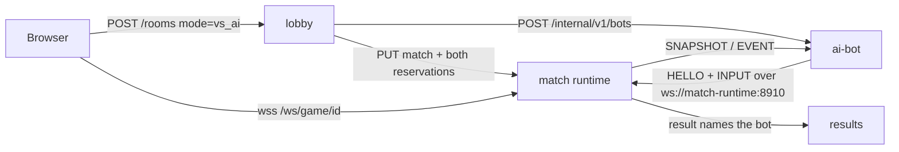

# The online AI opponent (Milestone 5)

The ai-bot service lets one person play an online match against the computer. It is the
optional fourth business service of the online system and the evidence for the optional
"Agentes AI" criterion of the brief. The bot is a heuristic agent, not an LLM: it has a
goal, reads observations from its environment, decides on its own in a loop, and acts
through the same interface a human uses.

## Where it sits



- The **match runtime is unchanged**. The bot is a remote player: it authenticates with
  a lobby-signed credential for team 1, sends INPUT frames and receives snapshots and
  events. The runtime cannot tell it from a browser, and the same input rules apply
  (one action per kind per tick, server-measured shot charge, neutral input after
  250 ms of silence).
- **Only the human role is replaced.** The other ten players of the bot's team are still
  driven by the runtime's own `AIController`, at the difficulty the lobby put into
  `MatchConfig.team_difficulty[1]`. Easy / Normal / Hard therefore change both the bot's
  play and its team-mates'.
- The lobby passes the **internal** URL `ws://match-runtime:8910/ws/game/<match_id>`;
  the bot never goes through the public gateway.

## The agent

| | |
| --- | --- |
| **Goal** | Win the match: score, and stop the opponent scoring. |
| **Environment** | The authoritative match on the runtime, seen only through the protocol. |
| **Observations** | The newest SNAPSHOT (not the 100 ms delayed render buffer) written into a mirror `MatchSimulation` that is never stepped: every player's position, velocity, facing, stamina, stun/tackle flags, possession, the bot team's selected player and the runtime's switch candidate, the clock, half, phase and restart state. The ends are switched in the mirror when the half changes (the snapshot carries positions, not sides). Events (`kickoff`, `match_over`) drive the job state. |
| **Decide** | `BotBrain` (`scripts/bot/bot_brain.gd`), every think interval (the difficulty's reaction time, +-15 % jitter). Read-only tactical queries are shared with the in-sim AI through `scripts/ai/tactics.gd`: best pass target, most open dribble lane, shot corner away from the keeper, nearest opponent. |
| **Act** | An `InputSnapshot` per physics tick (60 Hz): held move axis and sprint, one-tick pass / switch / tackle presses, and shots as a held charge released with an aim point. `NetClient.send_input` turns it into the numbered actions of the wire protocol. |

The decision rules, by situation of the bot's selected player:

| Situation | Decision |
| --- | --- |
| Not live (waiting, paused, goal freeze, half time, restart freeze) | Let go of every input. |
| We have the ball | Shoot when inside the difficulty's range and facing goal (charge drawn from the difficulty's range, aim at the far corner plus aim error). Else pass when pressed with no open lane ahead (recycling it, but never more than 0.35 back toward our goal) or when an open mate is clearly closer to goal (the runtime picks the receiver with the same `Tactics.best_pass_target`). Else dribble along the most open lane, sprinting into space while stamina lasts. |
| They have the ball | Switch to the runtime's candidate when it is clearly nearer the carrier. If their keeper holds it, drop back into shape. Else close down goal-side of the carrier, reading his run (lead time); once close, step in front of the ball (which runs ahead of the carrier's feet) and tackle it when within reach. Never from behind (that is a foul), never while stunned, with a cooldown. |
| Loose ball | Switch to the best interceptor if clearly nearer, else run onto where the ball will be. |

Small steering noise is added to every movement, so the bot never moves on rails.

### Difficulty parameters (`BotBrain.PROFILES`)

| | Easy | Normal | Hard |
| --- | --- | --- | --- |
| Think / reaction interval | 0.45 s | 0.20 s | 0.10 s |
| Shot aim error (field units) | 0.09 | 0.045 | 0.015 |
| Steering noise (rad) | 0.35 | 0.15 | 0.05 |
| Shooting range | 0.34 | 0.44 | 0.50 |
| Pressure distance (feels pressed when closer) | 0.08 | 0.11 | 0.13 |
| Goal-distance gain that justifies a forward pass | 0.35 | 0.25 | 0.18 |
| Tackle range to the ball / cooldown (Easy lunges early and whiffs more) | 0.09 / 1.0 s | 0.065 / 0.8 s | 0.07 / 0.6 s |
| Switch margin | 0.15 | 0.10 | 0.06 |
| Minimum stamina to sprint | 0.6 | 0.4 | 0.25 |
| Shot charge (0.85+ evolves into a special shot) | 0.35-0.6 | 0.55-0.8 | 0.7-0.95 |
| Carrier lead time | 0 s | 0.15 s | 0.25 s |
| Team-mates' AI (`team_difficulty[1]`) | Easy | Normal | Hard |

`tests/measure_bot_strength.gd` plays seeded local matches with the bot's input policy
(see [`measurements.md`](measurements.md#ai-bot-strength-by-difficulty) for a run): in
bot-vs-bot matches the harder level wins every decided match of every pairing.

### Seeing it reason

Each session logs one-line JSON on stdout (`docker compose logs ai-bot`). State changes
are always logged (`bot_accepted`, `bot_state` joined/playing/stopped/failed,
`bot_connection_lost`, `bot_reconnected`, `bot_match_over` with the action counters).
Decisions are **sampled**: a `bot_decision` line is written for a new intent or action at
most every 500 ms, with the number of decisions not logged since:

```json
{"svc":"ai-bot","event":"bot_decision","match_id":"...","team":1,"difficulty":"hard","match_time":41.2,"half":1,
 "score":[0,1],"intent":"attack","action":"shoot","reason":"in range and facing goal","player":9,
 "features":{"dist_goal":0.41,"facing":0.93,"nearest_opp":0.21,"power":0.84,"aim":[-0.93,-0.07]},"unlogged":3}
```

`BOT_DECISION_LOG=0` silences the decision lines. `GET /internal/v1/bots/{match_id}`
also returns the counters (inputs, decisions, shots, passes, tackles, switches,
reconnects).

## Service contract

`scripts/bot/bot_job_api.gd` (bearer `BOT_CONTROL_TOKEN`, internal network only):

- `POST /internal/v1/bots {match_id, token, ws_url, difficulty}`: 201 accepted, 200 the
  same request again (idempotent by match_id), 409 a different request for that match,
  400 invalid (the ws_url must point at `/ws/game/<match_id>`), 503 at capacity
  (`BOT_MAX_SESSIONS`, default 8).
- `GET /internal/v1/bots/{match_id}`: `accepted -> joined -> playing -> stopped | failed`
  with the reason; finished jobs stay readable for 10 minutes.
- `DELETE /internal/v1/bots/{match_id}`: stops the session (idempotent).
- `GET /health`: `{status, boot_id, active, capacity}` (the container healthcheck).

`BotSession` (`scripts/bot/bot_session.gd`) fails a job that is not welcomed within
10 s (`join_timeout`), whose credential is refused (4401/4404) or whose slot is taken by
another connection (4409). A connection lost after joining is retried with backoff for
up to 20 s, inside the runtime's 30 s reconnect grace. `match_over` or close 4410 stops it.

The lobby side (`services/lobby/app/service.py`, `bot_client.py`) creates the room only
once the job reports `joined`; on any failure it stops the job, cancels the runtime
match and deletes the room (503 `bot_unavailable`). Its reconciliation also cancels a
waiting vs-AI room whose bot job has stopped or failed, so a human is never left waiting
for a bot that is gone.

## Results

The bot plays under a stable guest id per difficulty
(`uuid5(6f1c3a52-9d4e-4c1b-8a57-2f0e8b7d4c21, "ai-bot:<difficulty>")`) named
`AI (Easy)`, `AI (Normal)` or `AI (Hard)`. It appears in match history under that name
and **is ranked on the leaderboard** like any guest (one row per difficulty), so players
can see how each level fares. The results service needed no change.

## Limitations

- One ai-bot process with bounded sessions; no routing across replicas (not needed at
  this scale, review finding 7).
- If the ai-bot process dies mid-match its sessions are gone: the runtime pauses the
  match and the human wins by forfeit after 30 s. A waiting vs-AI room is cancelled by
  the lobby's reconciliation (at the latest after its 30 s period).
- The bot observes the snapshot stream at 30 Hz plus one network hop, so even Hard reacts
  in roughly 100-150 ms. It does not predict the ball's flight beyond a linear lead.
