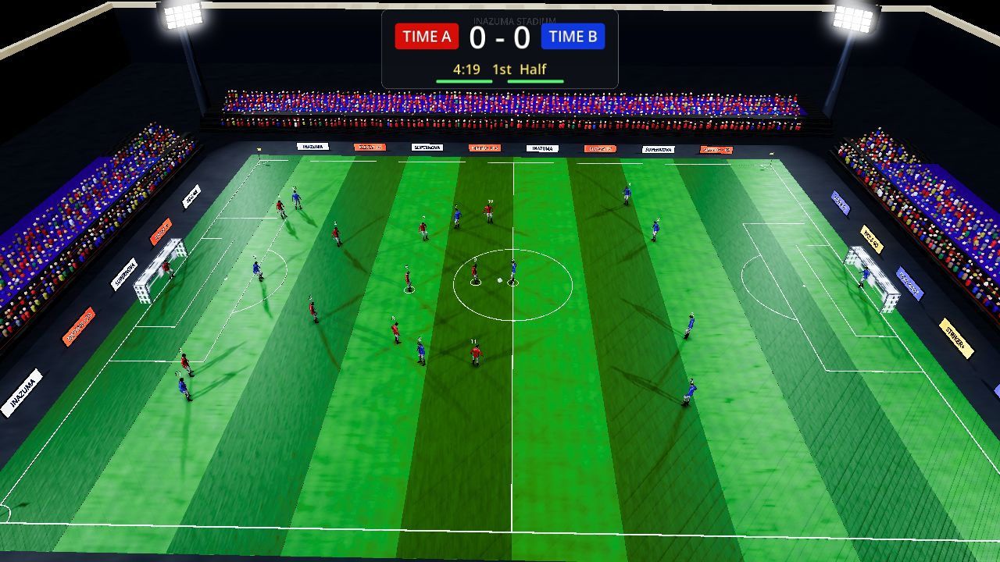
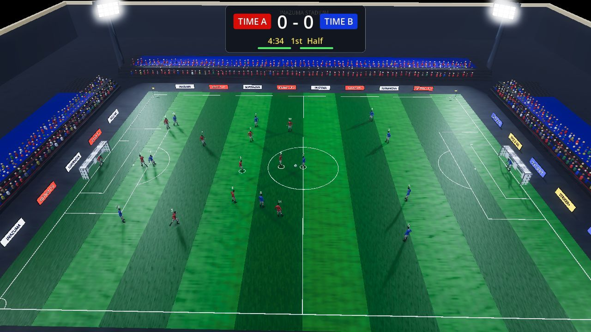

# Measurements (Milestones 4-5)

Numbers measured on the composed stack (`docker compose up --build`) on one development
machine: Windows 11, Docker Desktop (WSL 2), 16 logical CPUs, 16 GB. Everything goes
through the gateway, as in a deployment. Method first, then the numbers.

## Tools

| What | Tool | How it measures |
| --- | --- | --- |
| Input-to-visible delay, RTT, traffic of a desktop client | `tests/measure_latency.gd` | Two headless 3D games get seats from the real lobby (`LobbyClient`) and play through the gateway. Red runs `LatencyProbe`: from the physics tick that samples a move press (from standstill) to the first frame whose interpolated mirror shows the selected player moved 0.003 field units (~7 cm) that way. 12-16 presses of 400 ms per run, alternating right/left. RTT is the protocol's PING/PONG. Traffic comes from `NetClient.rx_stats`/`tx_stats`. |
| Browser frame time, start-up time, browser-side traffic | `tests/e2e/measure.mjs` | Two headless Chromium pages (960x540) play a lobby match. It records `requestAnimationFrame` intervals over 20 s (Godot's web main loop runs once per animation frame), the time from navigation to "environment ready", and every WebSocket frame by protocol message type. |
| Added network latency | `tc netem` | Applied to `lo` inside the gateway container's network namespace. The clients run in that namespace and connect to `localhost`, so the delay hits the client leg both ways: RTT grows by twice the netem delay. Gateway to runtime traffic is not delayed. |

```bash
# helper image with tc (iproute2) on top of the pinned toolchain image
printf 'FROM inazuma/godot:4.7.2\nRUN apt-get update && apt-get install -y --no-install-recommends iproute2\nENTRYPOINT ["tc"]\n' \
  | docker build -t inazuma/netem:local -
NET="--network container:inazuma-online-gateway-1"
docker run --rm $NET --cap-add NET_ADMIN inazuma/netem:local qdisc replace dev lo root netem delay 50ms
docker run --rm $NET -v "$PWD:/project" inazuma/godot:4.7.2 --headless --path /project \
  --script res://tests/measure_latency.gd -- --lobby=http://localhost/api/lobby/v1 --presses=16 --label=50ms
docker run --rm $NET --cap-add NET_ADMIN inazuma/netem:local qdisc del dev lo root

bash tests/e2e/run.sh measure.mjs tier-web 20 web     # browser, web tier
bash tests/e2e/run.sh measure.mjs tier-full 20 full   # browser, forced desktop tier
```

On Git Bash, prefix the `docker run` lines with `MSYS_NO_PATHCONV=1` and use `$(pwd -W)`.

## Input-to-visible delay

Desktop client (headless, so frame time is a few milliseconds and doesn't limit
anything):

| netem delay (each way) | RTT p50 | input-to-visible mean | p50 | p95 | max |
| --- | --- | --- | --- | --- | --- |
| none | 7 ms | 162 ms | 166 ms | 167 ms | 167 ms |
| 25 ms | 62 ms | 203 ms | 201 ms | 208 ms | 208 ms |
| 50 ms | 117 ms | 261 ms | 263 ms | 263 ms | 263 ms |
| 50 ms, 10 ms jitter (normal) | 131 ms | 254 ms | 256 ms | 276 ms | 276 ms |
| 100 ms | 213 ms | 357 ms | 352 ms | 367 ms | 367 ms |

The delay is about **155 ms + RTT**. The fixed part is the design, not the network:

- the SnapshotBuffer interpolation delay (`delay_ticks = 6`, 100 ms),
- the snapshot cadence (every 2 ticks: up to 33 ms),
- tick alignment on both ends (up to 17 ms each),
- about one tick for the player to cover the 7 cm threshold.

This matches the plan's estimate ("about 200 ms or more at 100 ms RTT"): it measured
261 ms at 117 ms RTT. Jitter of +-10 ms is absorbed by the 100 ms buffer: there were no
stalls or snaps, and only the p95 grows. There is no client-side prediction (out of
scope for v1). Prediction of the local player would remove most of the fixed part.

## Snapshot size and bandwidth

Identical from the desktop client and the browser:

| Message | Size | Rate | Bandwidth |
| --- | --- | --- | --- |
| SNAPSHOT (server -> client) | 383 B, fixed (22 players + ball + match state) | 30.0 /s | 11.5 KB/s (~92 kbit/s) |
| EVENT | ~80 B | a few per minute | negligible |
| PONG / PING | 14 B / 10 B | 1 /s | negligible |
| INPUT (client -> server) | 17 B with no actions | 60 /s (one per physics tick) | 1.0 KB/s |

These are WebSocket payload sizes. Framing, TLS and TCP/IP overhead come on top.
A match costs the server about 2 x 12.5 KB/s of payload, both players included.

## Browser frame time: web tier

Headless Chromium has no GPU, so WebGL 2 runs on SwiftShader (software). Absolute
numbers are about two orders of magnitude worse than a real browser with a GPU. They
still show what the web tier saves, because the scene, viewport and machine were the
same and the two pages rendered concurrently in every run.

| Build / tier | start-up to "environment ready" | frame time mean | p50 | p95 |
| --- | --- | --- | --- | --- |
| before Milestone 4 (commit 8a46b37) | 12.5 s | 1.58 s / 1.44 s | 1.55 s / 1.45 s | 2.12 s / 1.77 s |
| Milestone 4, `?quality=full` (the old configuration) | 16.3 s | 1.84 s / 1.77 s | 1.77 s / 1.77 s | 2.47 s / 2.02 s |
| Milestone 4, web tier (default on the web) | **2.2 s** | **0.98 s / 0.95 s** | **0.97 s / 0.95 s** | **1.20 s / 1.15 s** |

Two values are the red and blue pages. The "before" and "full" rows describe the same
scene; the difference between them is run-to-run load on the shared host. Compared in
one session, the web tier halves the frame time and cuts start-up by 7x. Start-up drops
because the 256-subdivision VoxelGI bake no longer runs. That bake is single-threaded
WebAssembly, and its result can't even be used by the Compatibility renderer.
Frame time drops for three reasons:

- two shadowed floodlights instead of four, and no lamp-accent omni lights (fewer shadow
  and light passes),
- half the crowd instances (5 rows at 0.85 spacing instead of 7 at 0.6),
- a 2048 shadow atlas instead of 4096.

SSAO, SSIL and volumetric fog cost nothing on Compatibility: the renderer doesn't
implement them, so skipping them saves no time. Their stand-ins (ambient fill,
depth fog, glow) are what keep the stadium readable without them.

The browser's own latency probe (`&latency=1`) gave ~1.9 s in this setup. That number
is frame-bound (one frame is about 1 s on SwiftShader) and says nothing about the
network path. The headless desktop client above is the meaningful measurement.

| Desktop tier forced on Compatibility (`?quality=full`) | Web tier |
| --- | --- |
|  |  |

(Both screenshots are SwiftShader renders of the Compatibility renderer. The desktop
Forward+ look with SSAO, SSIL, volumetric fog and VoxelGI is unchanged and isn't shown.)

## Slow consumer

With `netem delay 20ms rate 64kbit` on the same loopback, both clients share 64 kbit/s,
less than the ~2 x 92 kbit/s of snapshots they need. The desktop client then received
10.6 snapshots/s instead of 30. RTT climbed to 2.7 s within 16 s, so the queue grew
without bound, and no move press became visible within the probe's 3 s timeout. The
runtime never saw congestion: its WebSocket peer is the gateway, which reads promptly.
The backlog builds up in Caddy and the kernel socket buffers instead, so the runtime's
own protection does not engage behind the gateway. That protection is "skip snapshots
while the outbound buffer is over 64 KB, disconnect after 5 s congested". Known
limitation: a client on a link slower than ~100 kbit/s gets an ever-growing delay instead
of being dropped or served fewer snapshots. A fix would need an end-to-end signal, e.g.
the client reporting its snapshot lag in INPUT/PING so the room can thin that peer's
snapshots.

## AI bot strength by difficulty

Milestone 5. `tests/measure_bot_strength.gd` plays seeded local matches (6 per line, 90 s
halves) in which `BotBrain` drives a team through the same `InputSnapshot` a remote
player sends, observing the session's own state (no network delay), with that team's
off-ball AI at the bot's difficulty as in a vs-AI room. The left name is team 0.

```bash
MSYS_NO_PATHCONV=1 docker run --rm -v "$(pwd -W):/project" inazuma/godot:4.7.2   --headless --path /project --script res://tests/measure_bot_strength.gd
```

| Match-up | Goals | Shots | Wins | Right-side possession |
| --- | --- | --- | --- | --- |
| Easy bot vs Normal bot | 7-39 | 30-72 | 0-6 | 46% |
| Normal bot vs Hard bot | 8-27 | 44-78 | 0-5 | 48% |
| Easy bot vs Hard bot | 3-48 | 19-98 | 0-6 | 44% |
| in-sim AI (Normal) vs Easy bot | 0-14 | 0-79 | 0-6 | 65% |
| in-sim AI (Normal) vs Normal bot | 1-23 | 2-71 | 0-6 | 61% |
| in-sim AI (Normal) vs Hard bot | 0-36 | 0-77 | 0-6 | 55% |

Bot against bot, the harder level wins every decided match, by a wide margin. Every level
beats the all-AI team, which in this build rarely shoots (the in-sim AI also took 1 shot
in 6 AI-vs-AI matches before this milestone), so the AI-vs-bot rows mostly show how
often each level converts its chances: 14, 23 and 36 goals for Easy, Normal and Hard.
Seeded runs repeat exactly within one engine build.

Over the real stack (`tests/e2e/run_bot_checks.sh`: one mostly idle browser against
Hard, 30 s halves, about one minute of play), the bot streamed 3876 input frames and
changed intent or acted 40 times: 4 shots, 5 passes, 9 tackles and 4 switches, about the
local rate of 4 shots per minute; 22 of those decisions were logged after sampling. That
match ended 0-0.
